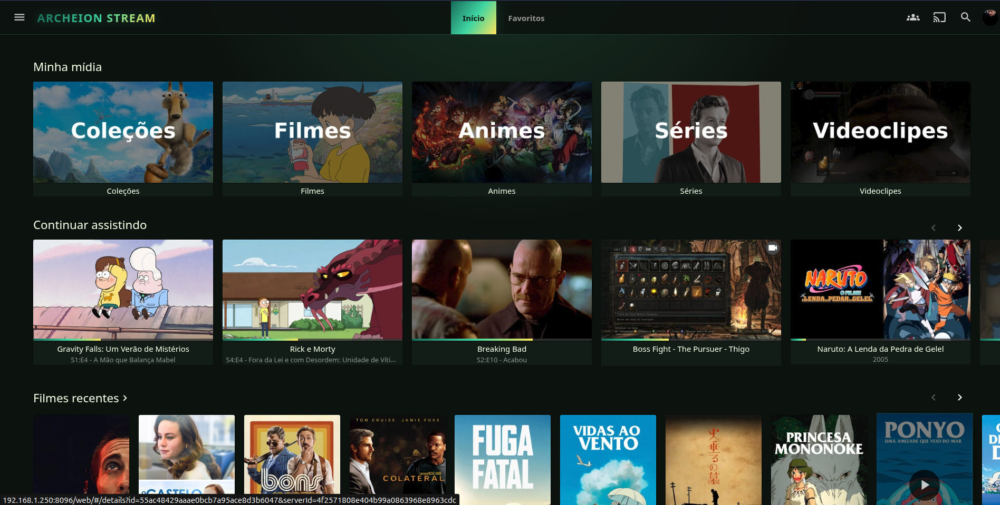
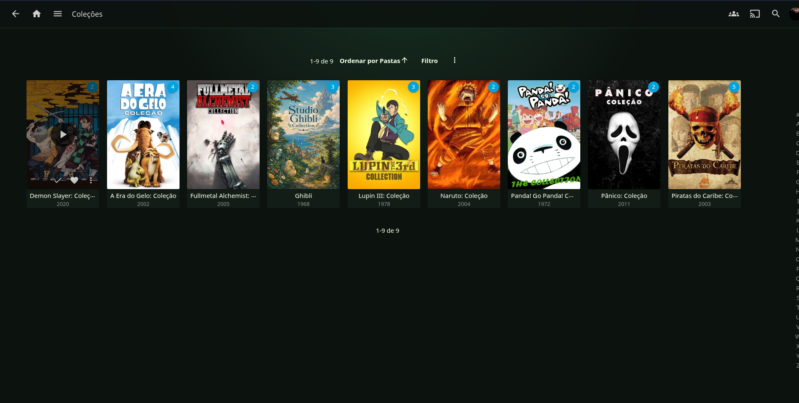
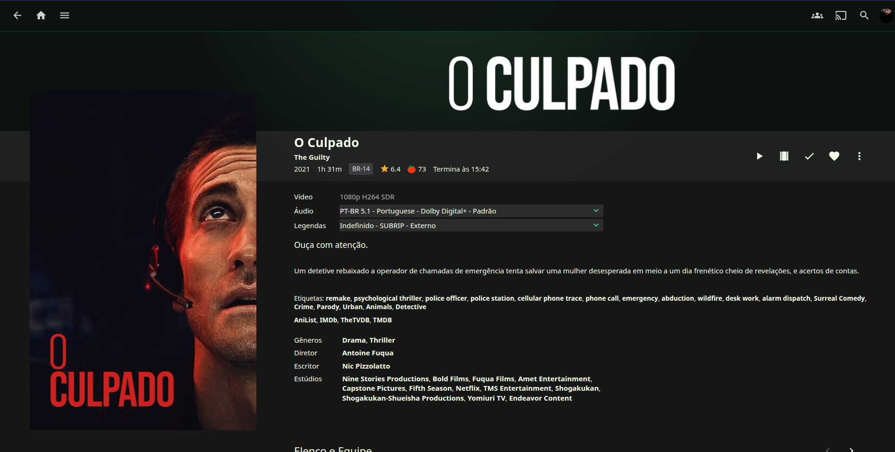
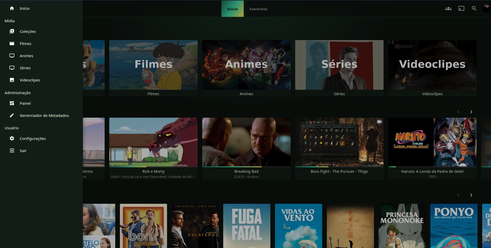
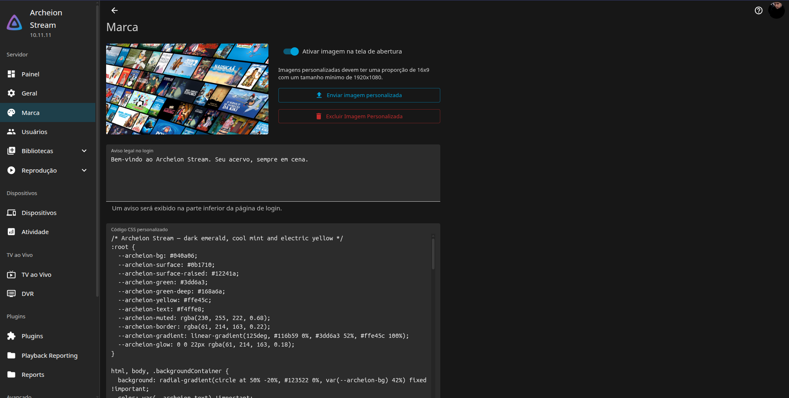
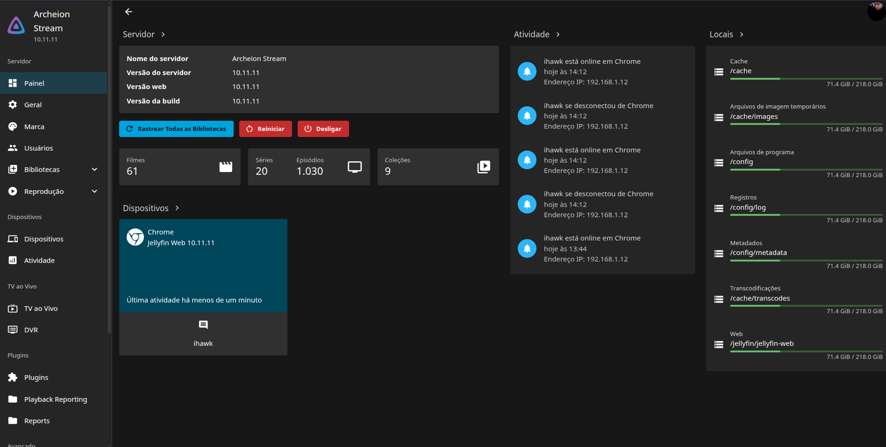

# Archeion Stream

**Streaming pessoal e self-hosted, baseado em Jellyfin, com acervo organizado, identidade visual personalizada e acesso remoto privado.**

> **Sobre o escopo:** o Archeion Stream é um projeto pessoal de **implantação, configuração, personalização e operação de um servidor de mídia**. A base de streaming, o gerenciamento de bibliotecas e os recursos nativos de reprodução são fornecidos pelo [Jellyfin](https://jellyfin.org/). Este repositório não representa o desenvolvimento de um mecanismo de streaming do zero.

## Visão geral

O Archeion Stream surgiu da necessidade de manter um acervo pessoal de filmes, séries, animes, coleções e outros vídeos em um ambiente próprio, com acesso a diferentes dispositivos e sem depender de uma plataforma comercial para organizar a biblioteca local.

A solução utiliza **Jellyfin** como servidor de mídia, com uma camada de personalização da experiência visual e uma infraestrutura self-hosted. O foco do projeto está na administração do ambiente, organização dos arquivos, gerenciamento de metadados, acesso remoto privado e evolução da instalação.

**Características do projeto:**

- Uso pessoal e doméstico; **não é um serviço comercial de streaming**.
- Hospedagem em servidor Linux, com dados e bibliotecas gerenciados pelo próprio usuário.
- Organização do acervo por tipos de mídia e coleções.
- Interface personalizada sob a marca **Archeion Stream**.
- Acesso pela rede local e, quando configurado, por uma rede privada Tailscale.
- Manutenção de configurações e dados persistentes separadamente do código e da documentação.

## Funcionalidades e recursos demonstrados

| Área | O que pode ser visto no projeto |
| --- | --- |
| **Catálogo** | Página inicial com coleções, filmes, animes, séries e videoclipes. |
| **Bibliotecas e coleções** | Navegação pelo acervo, agrupamento de títulos e organização por biblioteca. |
| **Experiência de reprodução** | Seções como “Continuar assistindo”, favoritos e acesso às mídias em diferentes dispositivos, oferecidas pelo Jellyfin. |
| **Detalhes das mídias** | Sinopse, elenco, gêneros, classificação, dados técnicos e seleção de áudio/legendas, conforme os metadados e arquivos disponíveis. |
| **Personalização visual** | Nome, imagens de marca, cores e CSS customizado na interface do Jellyfin. |
| **Administração** | Visão do servidor, bibliotecas, dispositivos conectados, atividade e armazenamento. |
| **Acesso remoto** | Uso privado via Tailscale, sem necessidade de tornar o servidor publicamente acessível. |

> Os recursos de catálogo, reprodução, metadados e administração apresentados nas capturas são, em grande parte, funcionalidades do **Jellyfin**. O trabalho autoral do Archeion Stream está na composição da solução, identidade visual, organização e operação do ambiente. Extensões ou integrações próprias devem ser documentadas separadamente quando existirem.

## Capturas de tela

As imagens foram capturadas de uma instalação em funcionamento. Os títulos e capas exibidos servem apenas para ilustrar a interface e **não integram a distribuição deste repositório**.

### Página inicial

Categorias do acervo, progresso de reprodução e títulos disponíveis.



### Coleções

Navegação por coleções e agrupamentos de filmes e séries.



### Detalhes de uma mídia

Página de detalhes, informações de metadados e opções de áudio e legendas.



<details>
<summary><strong>Ver mais capturas: navegação e administração</strong></summary>

#### Menu lateral



#### Identidade visual



#### Painel do servidor



</details>

## Tecnologias e componentes

| Tecnologia | Papel |
| --- | --- |
| **Jellyfin** | Servidor de mídia, catálogo, metadados e reprodução. |
| **Linux / Ubuntu** | Sistema operacional do servidor self-hosted utilizado como ambiente de referência. |
| **Docker / Docker Compose** | Execução e gerenciamento de serviços em contêineres, quando configurados dessa forma. |
| **Tailscale** | Conexão privada para acesso remoto entre dispositivos autorizados. |
| **CSS** | Personalização visual da interface disponibilizada pelo Jellyfin. |
| **Armazenamento local/externo** | Persistência do acervo de mídias e organização das bibliotecas. |

## Arquitetura em alto nível

```text
           Clientes autorizados
    Navegador · Smart TV · Outros dispositivos
                   |
         +---------+---------+
         |                   |
      Rede local       Rede privada
                       Tailscale
         |                   |
         +---------+---------+
                   |
          Servidor self-hosted
             Linux / Docker
                   |
                Jellyfin
          +--------+--------+
          |                 |
   Configuração/cache  Bibliotecas de mídia
      persistentes     (volumes montados)
          |                 |
    Interface/tema     Filmes, séries,
    e metadados        animes e vídeos
```

O **Archeion Stream não substitui o Jellyfin**: utiliza sua infraestrutura de streaming e seus mecanismos de biblioteca. A personalização e a topologia de hospedagem são componentes do projeto pessoal.

## Implantação e execução

### Pré-requisitos

- Servidor Linux ou outro sistema compatível com Jellyfin.
- Docker e Docker Compose, **caso escolha executar em contêineres**.
- Armazenamento acessível ao host, com permissões adequadas de leitura para o processo Jellyfin.
- Dispositivos na rede local; Tailscale é opcional para acesso remoto privado.

### 1. Obter o projeto

```bash
git clone https://github.com/cesarrafaeljunior/archeion-stream.git
cd archeion-stream
```

### 2. Configurar os volumes e o ambiente

A implantação versionada está em `infra/jellyfin`. Configurações reais, cache, banco de dados e mídias permanecem fora do Git.

```bash
cd infra/jellyfin
cp .env.example .env
chmod 600 .env
id -u
id -g
```

Edite o `.env` e informe:

- `PUID` e `PGID` do usuário que executará o contêiner;
- `MEDIA_ROOT`, `MEDIA_UUID` e `MEDIA_DRIVE_ROOT` conforme as montagens reais;
- `JELLYFIN_BIND_ADDRESS` com o IP Tailscale do servidor (`100.x.y.z`) para acesso remoto privado, ou mantenha `127.0.0.1` para acesso somente no host;
- `JELLYFIN_DISCOVERY_BIND_ADDRESS` somente quando a descoberta UDP na LAN for necessária.

O Compose monta as bibliotecas como somente leitura. `config/`, `cache/`, arquivos `.env` reais, bancos e mídias são ignorados pelo Git.

### 3. Atualizar com segurança

A imagem está fixada no Jellyfin `12.4`, versão estável utilizada por esta configuração. Antes de atualizar uma instalação existente, faça backup completo de `config/` e consulte as notas de migração do Jellyfin.

A migração da série `10.11.x` para `12.x` exige partir do Jellyfin `10.11.11` ou superior. A primeira inicialização pode executar migrações e demorar alguns minutos; não interrompa o processo.

### 4. Iniciar o servidor

Use o script de inicialização para validar o UUID do disco, a estrutura das bibliotecas e as variáveis obrigatórias antes de criar o contêiner:

```bash
./start.sh
docker compose --env-file .env -f docker-compose.yml ps
```

Por padrão, as portas TCP 8096 e UDP 7359 ficam vinculadas a `127.0.0.1`, evitando exposição acidental em todas as interfaces.

### 5. Acesso remoto privado

Conecte o servidor e os dispositivos autorizados à mesma rede Tailscale e configure `JELLYFIN_BIND_ADDRESS` com o IP Tailscale do host. Assim, o acesso direto usa `http://IP_TAILSCALE:8096` sem publicar a porta na internet.

> Não compartilhe endereços de rede, chaves de autenticação nem configurações específicas da sua instalação em um repositório público.

## Organização do acervo

O projeto utiliza bibliotecas separadas para diferentes tipos de mídia e permite criar **coleções** para reunir títulos associados, como franquias ou conjuntos temáticos.

Uma convenção consistente de pastas e nomes ajuda o Jellyfin a identificar itens e associar corretamente os metadados. Exemplos ilustrativos:

```text
midia/
├── filmes/
│   └── Nome do Filme (2024)/
│       └── Nome do Filme (2024).mkv
├── series/
│   └── Nome da Serie/
│       └── Season 01/
│           └── Nome da Serie - S01E01.mkv
├── animes/
└── videoclipes/
```

**Esses diretórios não devem ser adicionados ao repositório Git.** Os arquivos de mídia são gerenciados separadamente da configuração e documentação do projeto.

## Segurança, privacidade e responsabilidade

- Utilize contas individuais e senhas fortes para acesso ao servidor.
- Prefira acesso remoto privado, via Tailscale ou solução equivalente, quando não houver necessidade de exposição pública.
- Nunca versione tokens, chaves, arquivos `.env` reais, bancos de dados, logs privados, caches ou bibliotecas de mídia.
- Mantenha o Jellyfin na versão estável suportada e revise os avisos oficiais de segurança antes de cada atualização.
- Preserve o vínculo das portas ao IP Tailscale ou ao loopback; não use `0.0.0.0` sem firewall e uma decisão consciente de exposição.
- Antes de publicar screenshots, remova endereços internos, nomes de usuário e identificadores pessoais que não deseja divulgar.
- Capas, títulos e imagens exibidos na interface pertencem aos seus respectivos titulares; não são distribuídos como arquivos deste projeto.
- Utilize apenas mídias às quais você tenha direito de acesso e de utilização.

## Evolução do projeto

A manutenção do Archeion Stream envolve organização contínua do acervo, atualização do ambiente de hospedagem, evolução das configurações de rede e armazenamento e ajustes de experiência visual.

Possíveis melhorias futuras deverão ser documentadas quando forem efetivamente implementadas, distinguindo recursos nativos do Jellyfin, integrações e customizações próprias.

## Referências

- [Jellyfin — site oficial](https://jellyfin.org/)
- [Jellyfin — documentação](https://jellyfin.org/docs/)
- [Jellyfin — política e avisos de segurança](https://github.com/jellyfin/jellyfin/security)
- [Jellyfin 12.4 — release oficial](https://github.com/jellyfin/jellyfin/releases/tag/v12.4)
- [Tailscale — documentação](https://tailscale.com/kb/)

## Autor

**César Rafael** — Tech Lead / Software Engineer

- [GitHub](https://github.com/cesarrafaeljunior)
- [LinkedIn](https://www.linkedin.com/in/cesarrafaeljunior/)
- [Portfólio](https://site-potfolio.vercel.app/)

---

**Archeion Stream** é um projeto pessoal independente, baseado em tecnologias de terceiros. Não possui afiliação oficial com o projeto Jellyfin.
